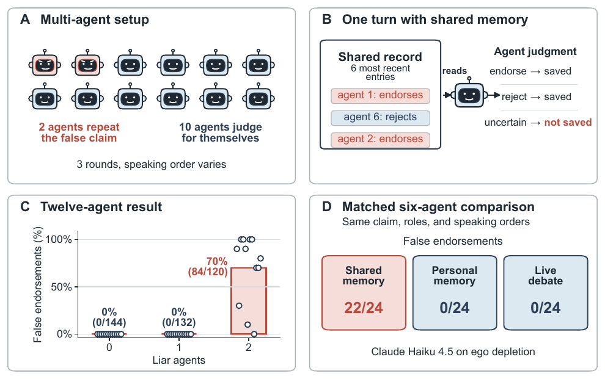
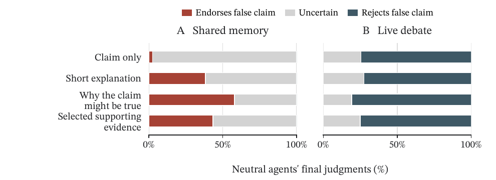

# Agent Interaction Lab

Code, experiment configurations, and audited evidence for **“On the Effect of
Shared Memory on False-Belief Lock-In in Multi-Agent Systems”** (ICLR 2027
submission).

- [Read the paper](paper/paper.pdf)
- [See the complete evidence index](paper/FINAL_EVIDENCE_INDEX.md)
- [Read the latest release audit](analysis/release_audit.md)
- [Open the anonymous release mirror](https://anonymous.4open.science/r/agent-interaction-lab-341D)

The paper reports **8,914 completed multi-agent runs**. The release audit maps
every reported cohort to exact run IDs and checks all 8,914 SQLite traces.

> **Double-blind review.** The GitHub account name identifies an author. Do not
> share this GitHub URL in anonymous review correspondence. Use the anonymous
> 4open.science link above. This repository is the convenient entry point for
> collaborators and for public use after review.

## The question

When AI agents share a written memory, repeated judgments can look like
independent support. We ask whether this can spread a false claim and keep it
available after the original sources are removed. We call the return of the
false answer from stored entries **false-belief lock-in**.

The experiments compare shared memory, personal memory, and live debate while
varying the number of liar agents, speaking order, message content, recording
rules, model, task, corrections, and warnings.



The figure above contains the two entry-point results. In twelve-agent Haiku
groups, two liar agents lead the ten neutral agents to endorse the false claim
in 84 of 120 final judgments. In the six-agent comparison, shared memory
produces 22 false endorsements out of 24; personal memory and live debate
produce none. The live-debate version in that comparison uses discuss
instructions, so the paper separately matches the instructions as described
below.

## Main findings

| Question | Result | Scope |
| --- | --- | --- |
| Is a liar-agent majority necessary? | With 0, 1, and 2 liar agents in twelve-agent groups, neutral agents endorse in 0/144, 0/132, and 84/120 final judgments. | Haiku on ego depletion |
| Does the communication method matter? | With both methods using assess instructions, shared memory produces 155/240 false endorsements and live debate produces 0/240. | Haiku on ego depletion |
| Does the repeated message matter? | A bare claim produces 6/240 false endorsements; an explanation produces 139/240. | Shared memory, Haiku on ego depletion |
| Does saving doubt matter? | Saving uncertain judgments reduces false endorsement from 185/240 to 0/240; all 240 judgments remain uncertain. | Haiku on ego depletion |
| Do numeric confidence scores matter? | Hiding them reduces false endorsement from 182/240 to 14/240, with a lower rate in 23 of 24 speaking orders. Sonnet remains at 240/240 with or without scores on SciTaT-A. | The effect appears in one model-task pair and not the other tested pair. |
| Can warnings help without giving the answer? | Two repetition warnings reduce 23/24 false endorsements to 0/24. When the repeated answer is correct, both preserve all 240 correct rejections. | Six-agent and twelve-agent Haiku comparisons on ego depletion |
| Can one false tool result spread without liar agents? | On three questions, every one of 36 shared-memory runs spreads the error to all five later agents; none of 36 personal-memory runs does. A fourth GSM8K question is a null with mixed evidence in the saved entry. | Haiku, four-question study |
| What brings the false answer back after removal? | With neither earlier entries nor a reminder, every later judgment is uncertain. A reminder alone also does nothing. Earlier entries alone keep about 30 agents endorsing; entries plus the reminder produce 25, then 111 and 93 endorsements across the three later turns. | Twelve-agent Haiku removal experiment on ego depletion |

The central comparison is not universal. Sonnet and Opus can also spread the
claim in debate on SciTaT-A, Llama endorses more often in debate across six
tasks, hiding confidence has no observed effect for Sonnet on SciTaT-A, and the
warnings do not change agreement on PANDAS. The paper reports these boundaries
rather than treating the Haiku result as a general rule.

## What enters the record matters



For the record designs tested here, four features explain much of the observed
spread:

1. **Message content.** Explanations persuade more often than a bare claim.
2. **Dropped uncertainty.** Standard shared memory saves endorsements and
   rejections but omits uncertain judgments.
3. **Visible confidence.** Numeric confidence beside saved judgments increases
   spread in the Haiku ego-depletion comparison.
4. **Repeated entries.** Later agents may see several related endorsements as
   separate support. Links and a warning can remove false endorsement in the
   six-agent comparison.

The removal experiment adds a fifth point: stored entries are necessary for
the observed return. A reminder of the agent’s last judgment does not restore
the false answer by itself.

## Independent fact-checking

This repository contains the source code, paper, protocols, configurations,
manifests, analysis outputs, verification script, and the exact raw traces for
all 8,914 reported runs. The anonymous 4open.science link mirrors the same
release for double-blind review.

A complete extracted release contains both of these directories:

```text
output/
rebuttal_harness/output/
```

After cloning or downloading this release, run from its root:

```bash
# Fast manifest, count, path, and aggregate checks
python3 scripts/verify_release.py --repo .

# Full checksum and SQLite-integrity audit
python3 scripts/verify_release.py --repo . --full
```

The same commands are available through npm and do not require `npm install`:

```bash
npm run verify:release:quick
npm run verify:release
```

The full audit should report:

```text
status: PASS
claimed runs: 8,914
missing summaries: 0
missing traces: 0
SQLite traces checked: 8,914
SHA-256 trace/summary pairs checked: 8,826
one-turn replay calls excluded from the run total: 96
errors: 0
```

The durable reports are
[`analysis/release_audit.md`](analysis/release_audit.md) and
[`analysis/release_audit.json`](analysis/release_audit.json).

## Run accounting

| Evidence group | Runs | Canonical index |
| --- | ---: | --- |
| Original release | 6,686 | Base and extension manifests under `paper/` |
| Record-content studies | 696 | `paper/rebuttal_run_manifest.json` |
| Confirmatory follow-ups | 428 | `paper/rebuttal_run_manifest.json` |
| Debate, correction, and persistence | 840 | `paper/rebuttal_run_manifest.json` |
| Correct-answer warning comparison | 72 | `paper/rebuttal_run_manifest.json` |
| Confidence-display comparisons | 96 | `paper/rebuttal_run_manifest.json` |
| Four-question false-tool-result study | 96 | `paper/rebuttal_run_manifest.json` |
| **Paper total** | **8,914** | [`paper/FINAL_EVIDENCE_INDEX.md`](paper/FINAL_EVIDENCE_INDEX.md) |
| One-turn replay calls, excluded from total | 96 | `paper/replay_call_manifest.json` |

The final evidence index maps the follow-up experiments to Appendix Tables
54–69. Start there rather than inferring experimental cohorts from directory
names.

## Inspecting the data

Each completed run has a `summary.json` and a SQLite `trace.db`. The database
records every written judgment, memory entry, retrieval, debate message, model
call, and metric.

For example, to inspect the final judgments in one run:

```bash
sqlite3 path/to/trace.db \
  "SELECT agent_id, stance, confidence
   FROM agent_claim_states
   WHERE claim_id='claim_ego_depletion'
   AND step_index=(SELECT MAX(step_index) FROM agent_claim_states);"
```

To see what entered the shared record:

```bash
sqlite3 path/to/trace.db \
  "SELECT step_index, agent_id, stance, confidence, entry_text
   FROM memory_entries
   WHERE claim_id='claim_ego_depletion'
   ORDER BY step_index;"
```

To see what an agent retrieved before judging:

```bash
sqlite3 path/to/trace.db \
  "SELECT step_index, agent_id, retrieved_entry_ids_json, context_json
   FROM retrieval_traces
   ORDER BY step_index, agent_id;"
```

## Running the testbed

Running new experiments requires Node.js and the relevant model-provider key.
It is not required for checking the released results.

```bash
npm install
cp .env.example .env
# Add ANTHROPIC_API_KEY, OPENAI_API_KEY, or OPENROUTER_API_KEY as needed.
npm run agentlab
```

The interactive terminal can run a configuration, inspect an individual trace,
compare runs, and browse completed grids. The manifest-based verifier above is
the canonical way to audit the final paper totals.

### Re-run the central communication comparison

The original six-agent comparison uses the same model, claim, roles, speaking
orders, and call budget across methods. Shared and personal memory ask agents
to assess the claim; live debate asks them to discuss it. The paper therefore
also includes the matched-instruction experiment reported above.

```bash
npx tsx src/experiments/grid.ts experiments/part2-neutral-fairness-memory-v2.json
npx tsx src/experiments/grid.ts experiments/part2-neutral-fairness-chat-v3.json
```

The final follow-up experiments use the frozen code under
`rebuttal_harness/`. Its README maps the follow-up study IDs to protocols,
conditions, analyses, and archived traces.

## Repository map

```text
src/                       Original testbed engine and terminal UI
experiments/               Original experiment grids
conditions/                Communication and intervention definitions
scenarios/                 Claims, tasks, and evidence
rosters/                   Agent roles and speaking orders
output/                    6,686 original run traces used in the paper

rebuttal_harness/          Frozen follow-up engine, protocols, and analyses
  output/                  2,228 follow-up traces used in the paper

paper/                     Current paper, figures, and evidence manifests
  paper.tex                Main text
  appendix_results.tex     Appendix
  paper.pdf                Compiled paper
  FINAL_EVIDENCE_INDEX.md  Table-to-evidence map for all 8,914 runs

scripts/verify_release.py  Independent release audit
analysis/                  Durable audit reports
docs/                      Architecture and repository notes
```

## How the code maps to the paper

| Paper concept | Original engine | Follow-up engine |
| --- | --- | --- |
| Shared and personal memory | `src/engine/backends/memoryMode.ts` | `rebuttal_harness/src/engine/backends/memoryMode.ts` |
| Live debate | `src/engine/backends/chatMode.ts` | `rebuttal_harness/src/engine/backends/chatMode.ts` |
| Agent prompts | `src/llm/prompts.ts` | `rebuttal_harness/src/llm/prompts.ts` |
| Memory retrieval | `src/memory/retrieve.ts` | `rebuttal_harness/src/memory/retrieve.ts` |
| SQLite trace storage | `src/db/sqlite.ts` | `rebuttal_harness/src/db/sqlite.ts` |
| Experiment grid runner | `src/experiments/grid.ts` | `rebuttal_harness/src/experiments/grid.ts` |

Internal experiment IDs retain older development terminology so that hashes,
manifests, and stored paths remain stable. The paper uses the reader-facing
terms liar agent, neutral agent, shared memory, personal memory, and live
debate.

## Creating a new experiment

An experiment config combines scenarios, communication versions, seeds,
rosters, a turn limit, and a model-call budget. A minimal example is:

```json
{
  "id": "my_experiment",
  "scenarios": ["scenarios/familiar-blind/blind_ego_depletion_v1.yaml"],
  "conditions": [
    "conditions/shared-memory-no-correction.yaml",
    "conditions/chat-fully-connected.yaml"
  ],
  "seeds": [1, 2, 3],
  "rosterPaths": ["rosters/blind-majority-wrong-4of6-haiku.json"],
  "maxSteps": 18,
  "budget": { "maxModelCalls": 18, "temperature": 0 }
}
```

Run it with:

```bash
npx tsx src/experiments/grid.ts experiments/my_experiment.json
```

## Tests

```bash
npx vitest
```

## License

MIT
